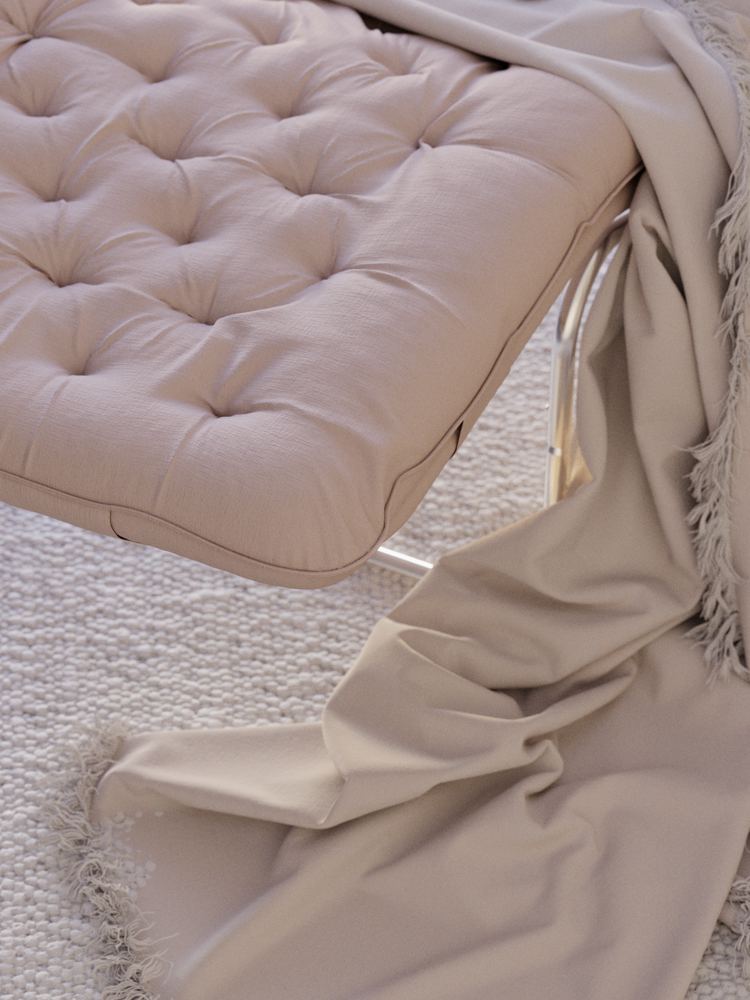
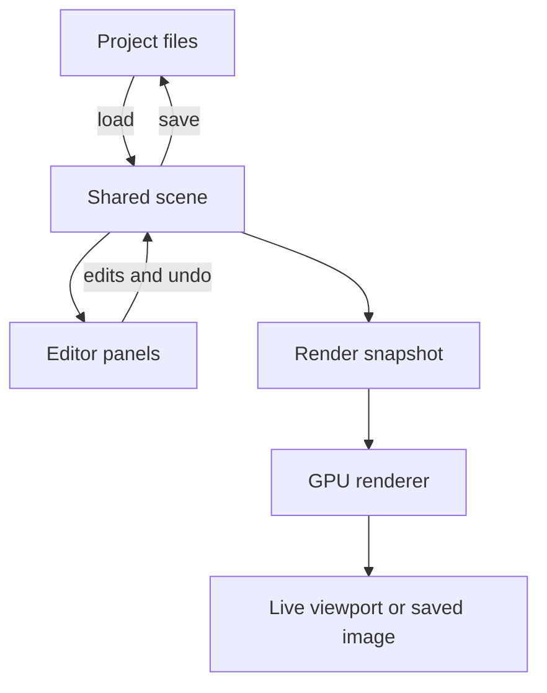
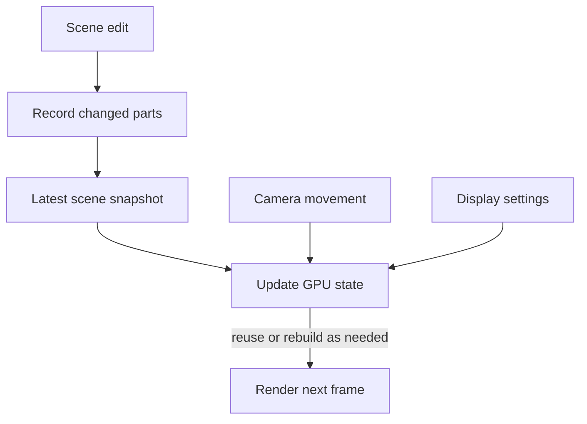
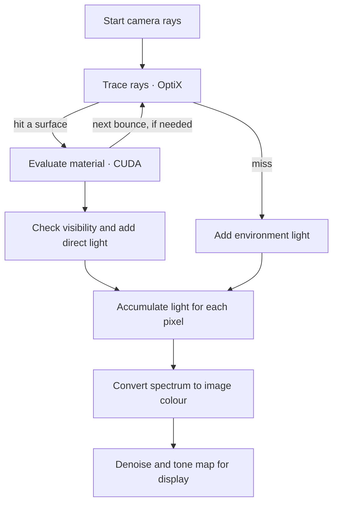

# Portfolio — Path-Traced Renders

Selected renders from my spectral GPU path tracer.
[View the gallery](https://nicolasgfx.github.io/Portfolio/) or read about
[the renderer](#the-renderer) below. Click an image for full resolution.

---

## Contents

**[Editor](#editor)** — the path tracer behind every image below

**Renders** —
[Poolhouse](#poolhouse) ·
[Watercolor](#watercolor) ·
[Kroken](#kroken) ·
[Bistro](#bistro) ·
[Zero-Day](#zero-day) ·
[Bathroom](#bathroom) ·
[Monster Under the Bed](#monster-under-the-bed) ·
[Classroom](#classroom) ·
[Transparent Machines](#transparent-machines) ·
[MaterialX Lion](#materialx-lion) ·
[The Old View](#the-old-view) ·
[Studies](#studies) (Hornet, Gelatinous Cube, Staircase, Spaceship)

**[The renderer](#the-renderer)** — how it works, with a
[case study](#case-study-retiring-the-megakernel) on making iteration faster

**[Credits &amp; licenses](#credits--licenses)** —
[Fan-art notice (Hornet)](#fan-art-notice-hornet) ·
[Fan-art notice (Gelatinous Cube)](#fan-art-notice-gelatinous-cube) ·
[Kroken — NoDerivatives](#kroken--noderivatives-permission-granted) ·
[Watercolor — Lucy Dreams EULA](#watercolor--lucy-dreams-eula-purchased) ·
[Bathroom — Fab Standard License](#bathroom--fab-standard-license) ·
[MaterialX Lion — ASWF Digital Assets License](#materialx-lion--aswf-digital-assets-license) ·
[The Old View — Blender comparison](#the-old-view--blender-comparison) ·
[Rights holders](#rights-holders)

---

## Editor

I direct the renderer’s architecture and testing, with AI-assisted implementation. Its editor brings together the scene tree, layered materials, and a live render preview. All gallery images use this renderer except the labelled Blender comparisons.

---

<table>
  <tr>
    <td width="50%" align="center"></td>
    <td width="50%" align="center"></td>
  </tr>
</table>

---

## Poolhouse

A villa scene I reworked with new geometry, materials, lighting, and staging, based on a Sketchfab model.

<table>
  <tr>
    <td width="50%" align="center"> <b>Hero — grass</b></td>
    <td width="50%" align="center"> <b>Hero — terrace</b></td>
  </tr>
  <tr>
    <td width="50%" align="center"> <b>Hero — interior</b></td>
    <td width="50%" align="center"> <b>Cinematic grade</b></td>
  </tr>
</table>

> Base model: *Modern luxury villa house building with pool** by zigurat
> architecture studio, licensed
> [CC BY 4.0](https://creativecommons.org/licenses/by/4.0/) and heavily modified
> here (geometry, materials, lighting, staging). CC BY permits modification with
> attribution and an indication of changes.

---

## Watercolor

Daylight fills an attic painting studio, from the worktable to the gallery wall.

<table>
  <tr>
    <td colspan="3" align="center"> <b>Studio</b></td>
  </tr>
  <tr>
    <td width="33%" align="center"> <b>Worktable</b></td>
    <td width="33%" align="center"> <b>Easel and trolley</b></td>
    <td width="33%" align="center"> <b>Gallery wall</b></td>
  </tr>
  <tr>
    <td width="33%" align="center"> <b>Drawer cabinet</b></td>
    <td width="33%" align="center"> <b>Paint table</b></td>
    <td width="33%" align="center"> <b>Paints from above</b></td>
  </tr>
  <tr>
    <td width="33%" align="center"> <b>Watercolor sketch</b></td>
    <td width="33%" align="center"> <b>Pens and swatches</b></td>
    <td width="33%" align="center"> <b>Wicker chair</b></td>
  </tr>
</table>

> Scene: *Watercolor room interior scene** by Angelo Ferretti / Lucy Dreams,
> purchased under the [Lucy Dreams EULA](https://www.lucydreams.it/shop/eula-license/);
> rendered from its pbrt-v4 port with a replaced environment map from
> [Poly Haven](https://polyhaven.com/hdris) ([CC0](https://creativecommons.org/publicdomain/zero/1.0/)) (see the
> [note](#watercolor--lucy-dreams-eula-purchased) below).

---

## Kroken

A chair and chaise longue beside a shelving wall, with close-ups of fabric, glass, and small objects.

<table>
  <tr>
    <td width="50%" align="center"> <b>Main</b></td>
    <td width="50%" align="center"> <b>Clay render</b></td>
  </tr>
  <tr>
    <td width="50%" align="center"> <b>Chaise longue</b></td>
    <td width="50%" align="center"> <b>Shelf</b></td>
  </tr>
  <tr>
    <td width="50%" align="center"> <b>Shelf detail</b></td>
    <td width="50%" align="center"> <b>Blanket detail — top</b></td>
  </tr>
  <tr>
    <td width="50%" align="center"> <b>Blanket detail — front</b></td>
    <td width="50%" align="center"> <b>Moka detail</b></td>
  </tr>
  <tr>
    <td width="50%" align="center"> <b>Dispenser</b></td>
    <td width="50%" align="center"> <b>Red glasses</b></td>
  </tr>
</table>

> Scene: *Kroken** by Angelo Ferretti / Lucy Dreams, licensed
> [CC BY-ND 4.0](https://creativecommons.org/licenses/by-nd/4.0/) — published with
> the author's written permission (see the
> [note](#kroken--noderivatives-permission-granted) below).

---

## Bistro

The Amazon Lumberyard Bistro in warm evening light.

<table>
  <tr>
    <td width="50%" align="center"> <b>Vespa</b></td>
    <td width="50%" align="center"> <b>Café</b></td>
  </tr>
  <tr>
    <td width="50%" align="center"> <b>Le Chevalier</b></td>
    <td width="50%" align="center"> <b>Clay render</b></td>
  </tr>
</table>

---

## Zero-Day

A neon-lit corridor from Beeple’s short film, showing how coloured light bounces through a scene.

<table>
  <tr>
    <td width="50%" align="center"></td>
    <td width="50%" align="center"></td>
  </tr>
</table>

---

## Bathroom

Soft window light across reflective tiles and chrome fixtures.

<table>
  <tr>
    <td width="50%" align="center"></td>
    <td width="50%"></td>
  </tr>
</table>

---

## Monster Under the Bed

A creature beneath a bed, used to study how light scatters inside a translucent material.

<table>
  <tr>
    <td width="50%" align="center"></td>
    <td width="50%"></td>
  </tr>
</table>

---

## Classroom

The Blender classroom scene, lit by daylight through the blinds.

<table>
  <tr>
    <td width="50%" align="center"></td>
    <td width="50%"></td>
  </tr>
</table>

---

## Transparent Machines

Glass gears and nested shells from Beeple’s Transparent Machines. Rays need many bounces to pass through the overlapping surfaces.

<table>
  <tr>
    <td width="50%" align="center"> <b>Main</b></td>
    <td width="50%" align="center"> <b>Close-up</b></td>
  </tr>
</table>

---

## MaterialX Lion

Cracked ceramic glaze over gold leaf, built with layered MaterialX materials. The close-up shows the metal beneath the glaze. See the [asset notice](#materialx-lion--aswf-digital-assets-license).

<table>
  <tr>
    <td width="50%" align="center"> <b>Main</b></td>
    <td width="50%" align="center"> <b>Glaze detail</b></td>
  </tr>
</table>

---

## The Old View

A replica of Valley View Mall, featured in Kane Pixels’ The Oldest View. Each pair uses the same scene and camera: Blender 5.1 on the left, my path tracer on the right, both rendered by me. See the [comparison notice](#the-old-view--blender-comparison).

<table>
  <tr>
    <td width="50%" align="center"> <b>Balcony — Blender 5.1</b></td>
    <td width="50%" align="center"> <b>Balcony — my path tracer</b></td>
  </tr>
  <tr>
    <td width="50%" align="center"> <b>Puppet — Blender 5.1</b></td>
    <td width="50%" align="center"> <b>Puppet — my path tracer</b></td>
  </tr>
  <tr>
    <td width="50%" align="center"> <b>Atrium — Blender 5.1</b></td>
    <td width="50%" align="center"> <b>Atrium — my path tracer</b></td>
  </tr>
</table>

---

## Studies

Small studies in lighting, reflection, and translucent materials.

<table>
  <tr>
    <td width="64%" align="center"> <b>Hornet — fan art</b></td>
    <td width="36%" align="center"> <b>Gelatinous Cube — fan art</b></td>
  </tr>
  <tr>
    <td width="36%" align="center"> <b>Staircase</b></td>
    <td width="64%" align="center"> <b>4060.b Spaceship</b></td>
  </tr>
</table>

- **Hornet** — warm light and a looping light trail. [Unofficial fan art](#fan-art-notice-hornet).
- **Gelatinous Cube** — light bending, absorption, and scattering inside a translucent creature. [Unofficial fan art](#fan-art-notice-gelatinous-cube).
- **Staircase** — soft shadows and bounced daylight.
- **4060.b Spaceship** — chrome and glass under studio lighting.

---

## The renderer

A GPU path tracer that follows light through a scene to build an image. It tracks wavelengths, so effects such as glass dispersion and thin-film colour emerge from the light simulation.

**Light and colour**

- Each path samples four wavelengths. This supports dispersion in glass, measured metal reflectance, and the shifting colours of thin films.
- Light can scatter inside translucent materials and pass through overlapping glass objects. Specialised sampling helps find light through windows and refractive surfaces.

**Materials and sampling**

- Rough glass, brushed metal, and layered coatings share a material system. Layers account for how a coat changes the light reaching the surface beneath it.
- A light hierarchy helps choose useful lights in complex scenes. Carefully distributed samples reduce noise; optional path guiding learns promising directions as rendering progresses.

**Running on the GPU**

- OptiX traces rays; CUDA kernels handle shading and image processing. The renderer groups similar work into stages, a design called wavefront rendering.
- Instances share mesh data, and texture resolution adapts to the GPU memory budget. The display pipeline removes bright outliers, denoises, and applies bloom and tone mapping.

**Checking the results**

- Energy tests check that materials do not create extra light. One glass test exposed double-counted lighting: it returned 2.17 where the expected result was 1.0.
- Statistical tests check the sampling routines. Before each change, I define what should stay identical and what should change; design decisions record the evidence and tradeoffs.

### Case study: retiring the megakernel

The original renderer ran the whole light path in one large GPU program, or megakernel. A material edit meant 23.5 minutes of compilation, followed by 35.1 minutes to create the module on a cold start. That made small experiments expensive.

I chose to split the work into smaller wavefront stages, with performance and image checks set before the AI-assisted implementation began. The change cut build and startup times and improved rendering speed in the measured scenes.

| Measured | Megakernel | Wavefront |
| --- | --- | --- |
| Shading compilation | 23.5 min | 3–4 s per stage |
| Cold module creation | 35.1 min | 1.7 s for three main modules |
| Rendering speed | 1× baseline | 1.56–1.85× faster |
| Average image brightness | Reference | Within ±0.01% in 5 of 6 comparisons; +0.0323% in the sixth |

Build/startup measurements: 11 September 2026. Rendering: Kroken and Watercolor at 1920×1080, 128–512 samples per pixel, denoising off, both backends in the same binary, with single interleaved runs. These are scene-specific results. Subsurface scattering uses a separate 8.5 MB module that takes 138 s to create cold.

The main gain was a shorter feedback loop: material changes became practical to test one at a time. Brightness comparisons were backed by sampling and energy tests, including a deliberately broken build to check that the tests caught the error.

### Architecture

**From scene to image**

The editor and renderer share one scene model. Editor panels read from it, while the renderer receives a fixed snapshot so editing can continue during a render.

**Updating only what changed**

Edits update revision counters, which tell the renderer what needs refreshing. Camera and display settings have direct update paths. The GPU context and texture pool survive scene rebuilds.

**How a light path becomes a pixel**

Rays start at the camera. At each surface, the renderer evaluates the material, checks light visibility, and may continue the path with another bounce. This shows the main flow; glass and subsurface scattering add specialised steps.

The renderer repository is private. [Source available on request](mailto:drnicolasmenzel@gmail.com).

---

## Credits & licenses

All images here are renders I produced with my own path tracer — except the
left-hand images of [The Old View](#the-old-view) comparison, which I
rendered in Blender 5.1. The underlying
3D scenes and models were created by the artists credited below and used under
the stated licenses; **each render is a new image derived from those assets.**
Trademarks and characters are the property of their respective owners.

| Render | Scene / model — author | Source | License |
| --- | --- | --- | --- |
| Poolhouse *(heavily modified)** | *Modern luxury villa house building with pool** — zigurat architecture studio | [Sketchfab](https://sketchfab.com/3d-models/modern-luxury-villa-house-building-with-pool-0e858284939343cb994233d40a48a20a) | [CC BY 4.0](https://creativecommons.org/licenses/by/4.0/) |
| Bistro (Café, Vespa, Le Chevalier) | *Amazon Lumberyard Bistro** — Amazon Lumberyard | [NVIDIA ORCA](https://developer.nvidia.com/orca/amazon-lumberyard-bistro) · [pbrt-v4-scenes](https://github.com/mmp/pbrt-v4-scenes) | [CC BY 4.0](https://creativecommons.org/licenses/by/4.0/) |
| Zero-Day | *Zero-Day** — Mike Winkelmann (Beeple) | [beeple-crap.com/resources](https://www.beeple-crap.com/resources) | Free for any use, no attribution required (credited voluntarily) |
| Transparent Machines | Models from *Transparent Machines** — Mike Winkelmann (Beeple) | [beeple-crap.com/films](https://www.beeple-crap.com/films) · [pbrt-v4-scenes](https://github.com/mmp/pbrt-v4-scenes) | [Free for any use](https://www.beeple-crap.com/resources), no attribution required (credited voluntarily) |
| MaterialX Lion | *MaterialX Teapot and Lion** — NVIDIA Corporation | [ASWF blog](https://www.aswf.io/blog/materialxteapotlion/) · [DPEL](https://dpel.aswf.io/materialx-teapot-lion/) | [ASWF Digital Assets License v1.1](https://dpel.aswf.io/materialx-teapot-lion/materialx-teapot-lion-license) (non-commercial permitted uses; copyright notice required) |
| Hornet | *Silksong \|\| Hornet Fanart** — dark_igorek | [Sketchfab](https://sketchfab.com/3d-models/silksong-hornet-fanart-57d431b977c841ef8c117af82f109890) | [CC BY 4.0](https://creativecommons.org/licenses/by/4.0/) |
| Gelatinous Cube | *Gelatinous Cube** — glenatron | [Sketchfab](https://sketchfab.com/3d-models/gelatinous-cube-e08385238f4d4b59b012233a9fbdca21) | [CC BY-NC 4.0](https://creativecommons.org/licenses/by-nc/4.0/) (attribution required; non-commercial use only) |
| 4060.b Spaceship | *4060.b Spaceship** — thecali | [Blend Swap #13489](https://blendswap.com/blend/13489) | [CC0 1.0](https://creativecommons.org/publicdomain/zero/1.0/) (public domain; credited voluntarily) |
| Classroom | *Class room** — Christophe Seux | [Blender Demo Files](https://www.blender.org/download/demo-files/) | [CC0 1.0](https://creativecommons.org/publicdomain/zero/1.0/) (public domain; credited voluntarily) |
| Monster Under the Bed | Metin Seven, based on 2D concept art by Blake Stevenson | [Blender Demo Files](https://www.blender.org/download/demo-files/) | [CC BY 4.0](https://creativecommons.org/licenses/by/4.0/) |
| Staircase | *The Wooden Staircase** — Wig42 | [Blend Swap #14449](https://blendswap.com/blend/14449) | [CC BY](https://creativecommons.org/licenses/by/3.0/) |
| Bathroom | *Bathroom Scene 15** — PHI Archviz | [Fab](https://www.fab.com/listings/0a045566-e87c-4c54-927b-b40173523681) | [Fab Standard License](https://www.fab.com/eula) (Personal/Professional; no attribution required, credited voluntarily) |
| Kroken | Angelo Ferretti / Lucy Dreams | [lucydreams.it](https://www.lucydreams.it/kroken/) · [pbrt-v4-scenes](https://github.com/mmp/pbrt-v4-scenes) | [CC BY-ND 4.0](https://creativecommons.org/licenses/by-nd/4.0/) |
| Watercolor *(environment map replaced)** | *Watercolor room interior scene** — Angelo Ferretti / Lucy Dreams | [Lucy Dreams shop](https://gum.co/urfLv) · [pbrt-v4-scenes](https://github.com/mmp/pbrt-v4-scenes/tree/master/watercolor) | [Lucy Dreams EULA](https://www.lucydreams.it/shop/eula-license/) (purchased 2026-10-12; no attribution required, credited voluntarily) |
| The Old View | *Mall From The Oldest View – Project Files and Assets** — Šime Bugarija | [CGTrader](https://www.cgtrader.com/3d-models/interior/other/mall-from-the-oldest-view-project-files-and-assets) | [CGTrader Royalty Free License](https://www.cgtrader.com/pages/terms-and-conditions) (purchased for US$9; no attribution required, credited voluntarily) |

### Fan-art notice (Hornet)

The Hornet render is **unofficial fan art**. The character Hornet and *Hollow
Knight: Silksong* are trademarks and/or copyright of **Team Cherry**. This
non-commercial render is not affiliated with, authorized, sponsored, or endorsed
by Team Cherry. The underlying 3D model, *Silksong \|\| Hornet Fanart** by
dark_igorek, is used under [CC BY 4.0](https://creativecommons.org/licenses/by/4.0/).

### Fan-art notice (Gelatinous Cube)

The Gelatinous Cube render is **unofficial fan art**. The gelatinous cube is a
*Dungeons & Dragons* monster; D&D and its trade dress are trademarks of
**Wizards of the Coast**, and this render is not affiliated with, authorized,
sponsored, or endorsed by them. (The creature's game statistics appear in the
[CC BY 4.0](https://creativecommons.org/licenses/by/4.0/)-licensed SRD 5.1, but
that covers the rules text, not this artwork.)

The underlying 3D model, *Gelatinous Cube** by **glenatron**, is licensed
[CC BY-NC 4.0](https://creativecommons.org/licenses/by-nc/4.0/). Attribution is
given above, and the **NonCommercial** term is respected: this site carries no
advertising, sells nothing, and the renders are neither licensed nor offered for
sale. Should this portfolio ever be monetized, this render must be pulled or
separate permission obtained from the author.

### Kroken — NoDerivatives, permission granted

The Kroken scene is licensed **CC BY-ND 4.0**, which technically excludes
derivative works such as renders. Angelo Ferretti (Founder & Director, Lucy
Dreams — the scene's author), granted written permission by email on
**2026-07-03** to publish rendered images of the scene in this context,
subject to Lucy Dreams' [shop EULA/license
terms](https://www.lucydreams.it/shop/eula-license/). That email is kept on
file as proof of permission.

### Watercolor — Lucy Dreams EULA (purchased)

The [*Watercolor room interior scene**](https://gum.co/urfLv) by **Angelo
Ferretti** (Lucy Dreams) was purchased on **2026-10-12** under the
[Lucy Dreams EULA](https://www.lucydreams.it/shop/eula-license/), which permits
creating renderings from the scene, in personal and commercial work, and
modifying it for that purpose. It does not require attribution; the author is
credited here voluntarily. The renders were made from the scene's pbrt-v4 port in
[pbrt-v4-scenes](https://github.com/mmp/pbrt-v4-scenes/tree/master/watercolor),
using its supplied cameras with a replaced environment map from
[Poly Haven](https://polyhaven.com/hdris) ([CC0](https://creativecommons.org/publicdomain/zero/1.0/); no attribution
required, credited voluntarily). The scene files
themselves are not redistributed. The receipt is kept on file as proof of
license.

### Bathroom — Fab Standard License

The *Bathroom Scene 15** asset by **PHI Archviz** was purchased on
[Fab](https://www.fab.com/listings/0a045566-e87c-4c54-927b-b40173523681) under the
[Fab Standard License](https://www.fab.com/eula). That license grants the right to
use and modify the asset to produce final rendered images ("linear" end products
such as the still shown here) and to display it publicly. It does **not**
require attribution — the author is credited here voluntarily — and it does **not**
permit redistributing the underlying 3D asset files themselves. Only rendered
images are published in this repository, so the license terms are respected.

### MaterialX Lion — ASWF Digital Assets License

The lion renders show the *MaterialX Teapot and Lion**, an asset contributed
by **NVIDIA** to the Academy Software Foundation's [Digital Production Example
Library](https://dpel.aswf.io/materialx-teapot-lion/). Required notice:

> MaterialX Teapot and Lion Copyright 2026 NVIDIA Corporation. All rights reserved.

The [ASWF Digital Assets License
v1.1](https://dpel.aswf.io/materialx-teapot-lion/materialx-teapot-lion-license)
permits use for education, training, research, software and hardware
development, benchmarking and product demonstrations — which is what these
renders are — and requires publications showing derived images to carry that
copyright notice. The underlying asset files are **not** redistributed here, and
nothing in this repository implies endorsement by, sponsorship by, or
affiliation with NVIDIA.

### The Old View — Blender comparison

The mall scene, *Mall From The Oldest View – Project Files and Assets** by
**Šime Bugarija**, was purchased on
[CGTrader](https://www.cgtrader.com/3d-models/interior/other/mall-from-the-oldest-view-project-files-and-assets). Its license permits rendering the scene and publishing the resulting
images; the underlying 3D files are **not** redistributed in this repository.

Every image in the comparison — the Blender side included — was rendered by me
from the same scene and cameras. **Blender** is a registered trademark of the
Blender Foundation; this comparison is not affiliated with or endorsed by the
Blender Foundation. The mall is a replica of Valley View Mall (Dallas),
popularized by Kane Pixels' series *The Oldest View*; this repository is not
affiliated with Kane Pixels.

### Rights holders

Attribution and licenses above are provided in good faith. If you are a rights
holder and have a concern about any asset used here, contact
**drnicolasmenzel@gmail.com** and I will promptly address it.

---

> **Note:** The Old View entry assumes the CGTrader Royalty Free License; confirm
> the license named on your CGTrader order and update it if it differs.
>
> **Note:** The Staircase entry lists CC BY; confirm the exact CC-BY version
> shown on the [Blend Swap page](https://blendswap.com/blend/14449) and update
> the license link if it differs.

---
