# Nicolas Menzel — Path-Traced Renders

Renders from my spectral GPU path tracer. **[Open the gallery →](https://nicolasgfx.github.io/Portfolio/)** · click any image for full resolution.

[Editor](#editor) · [Poolhouse](#poolhouse) · [Watercolor](#watercolor) · [Knitted Bears](#knitted-bears) · [Kroken](#kroken) · [Bistro](#bistro) · [Zero-Day](#zero-day) · [Bathroom](#bathroom) · [Monster Under the Bed](#monster-under-the-bed) · [Classroom](#classroom) · [Transparent Machines](#transparent-machines) · [MaterialX Lion](#materialx-lion) · [The Old View](#the-old-view) · [Studies](#studies) · [Credits & licenses](#credits--licenses)

---

## Editor

My editor and spectral GPU path tracer. Every render here uses it, except the labelled Blender comparisons.

<a href="images/00_editor/2_editor.png">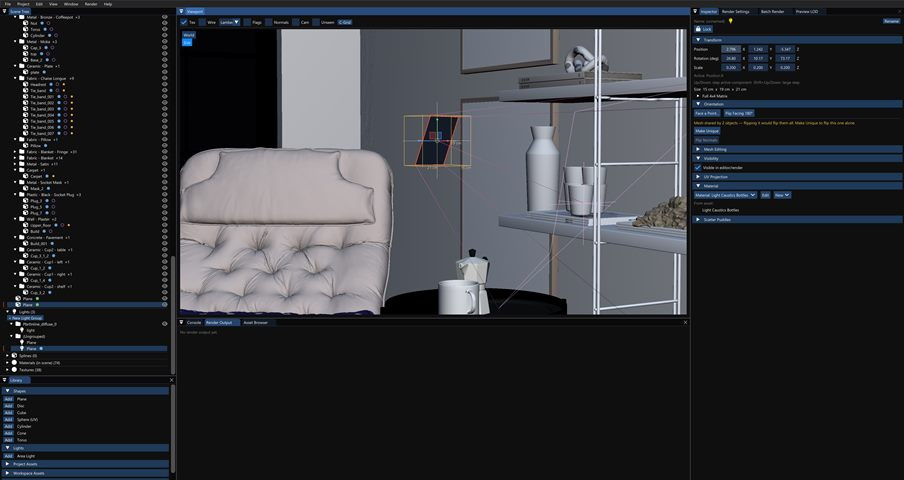</a>
<a href="images/00_editor/4_editor.png">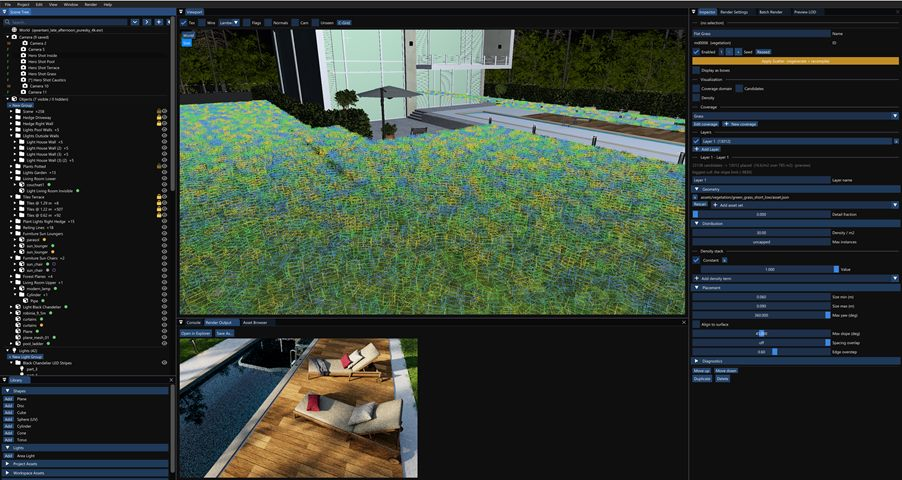</a>

## Poolhouse

[*Modern luxury villa house building with pool*](https://sketchfab.com/3d-models/modern-luxury-villa-house-building-with-pool-0e858284939343cb994233d40a48a20a) — zigurat architecture studio · [CC BY 4.0](https://creativecommons.org/licenses/by/4.0/) · heavily modified

<a href="images/05_poolhouse/01_Hero_Shot_Grass.png">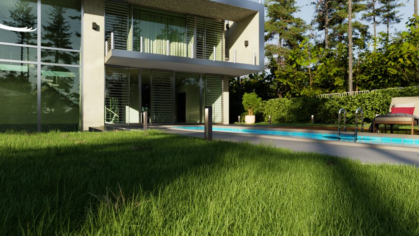</a>
<a href="images/05_poolhouse/02_Hero_Shot_Terrace.png">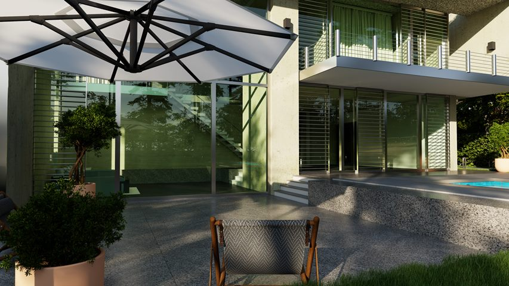</a>
<a href="images/05_poolhouse/03_Hero_Shot_Inside.png">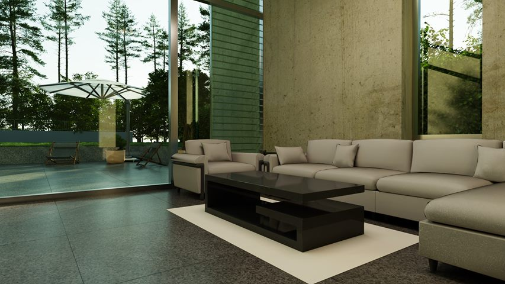</a>
<a href="images/05_poolhouse/04_grade_cinematic.png">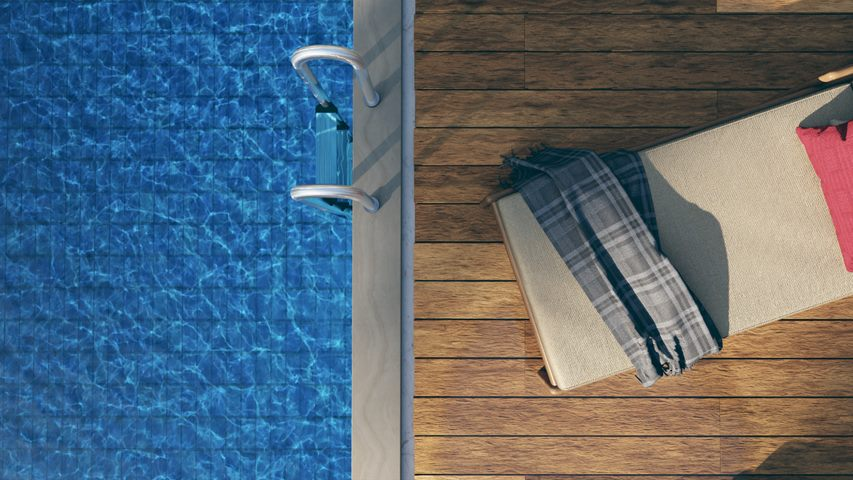</a>

## Watercolor

[*Watercolor room interior scene*](https://gum.co/urfLv) — Angelo Ferretti / Lucy Dreams · [Lucy Dreams EULA](https://www.lucydreams.it/shop/eula-license/) (purchased) · environment map: [Poly Haven](https://polyhaven.com/hdris) ([CC0](https://creativecommons.org/publicdomain/zero/1.0/)) · [note](#watercolor--lucy-dreams-eula-purchased)

<a href="images/01_watercolor/camera-1.png">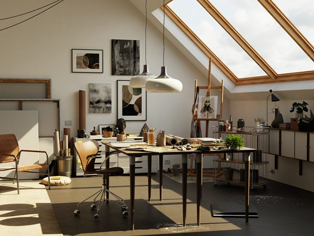</a>
<a href="images/01_watercolor/camera-13.png">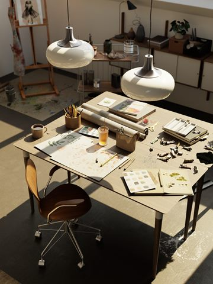</a>
<a href="images/01_watercolor/camera-9.png">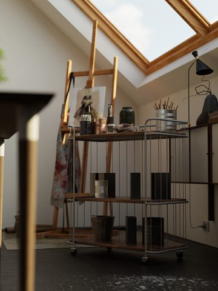</a>
<a href="images/01_watercolor/camera-10.png">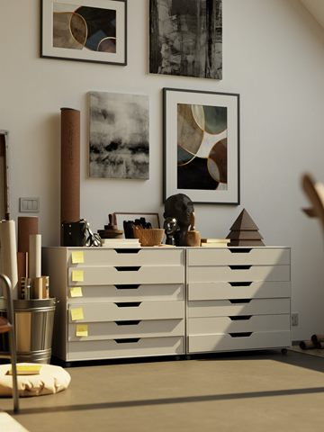</a>
<a href="images/01_watercolor/camera-3.png">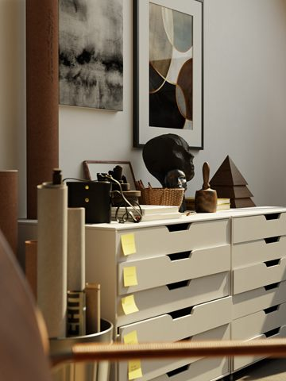</a>
<a href="images/01_watercolor/camera-7.png">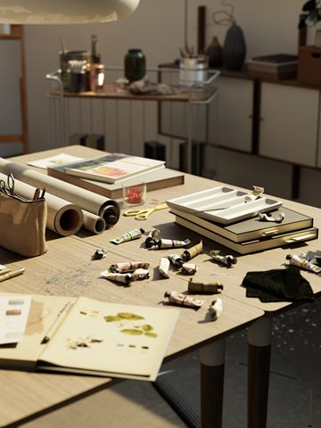</a>
<a href="images/01_watercolor/camera-12.png">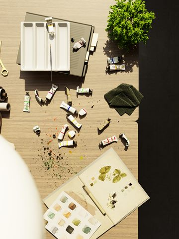</a>
<a href="images/01_watercolor/camera-6.png">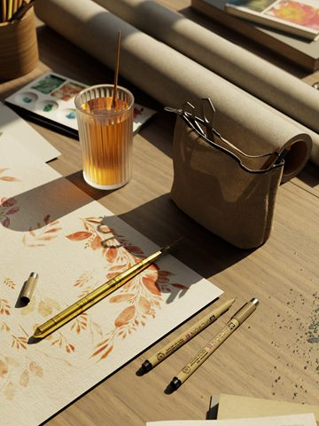</a>
<a href="images/01_watercolor/camera-8.png">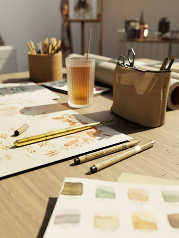</a>
<a href="images/01_watercolor/camera-16.png">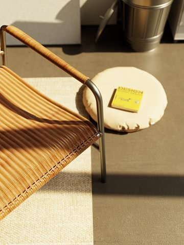</a>

## Knitted Bears

[*Teddy bears*](https://sketchfab.com/3d-models/teddy-bears-e84b12b4ac20402aaf4d40f2219cd0e2) — hectopod · [CC BY 4.0](https://creativecommons.org/licenses/by/4.0/) · knitted fibres added · background: [Watercolor](#watercolor) · [note](#knitted-bears--cc-by-40-model-in-a-purchased-scene)

<a href="images/02_knitted_bears/1.png">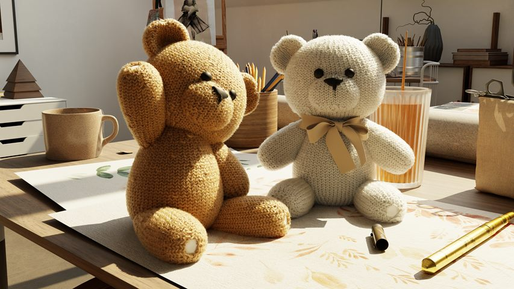</a>
<a href="images/02_knitted_bears/2.png">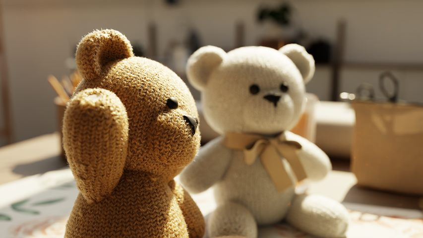</a>
<a href="images/02_knitted_bears/3.png">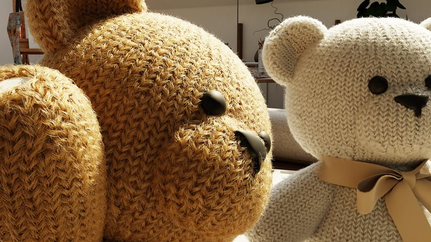</a>
<a href="images/02_knitted_bears/4.png">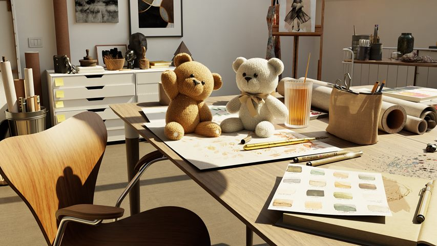</a>
<a href="images/02_knitted_bears/5_bears_editor1.png">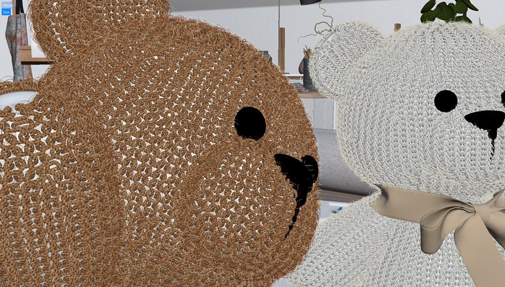</a>
<a href="images/02_knitted_bears/6_bears_editor2.png">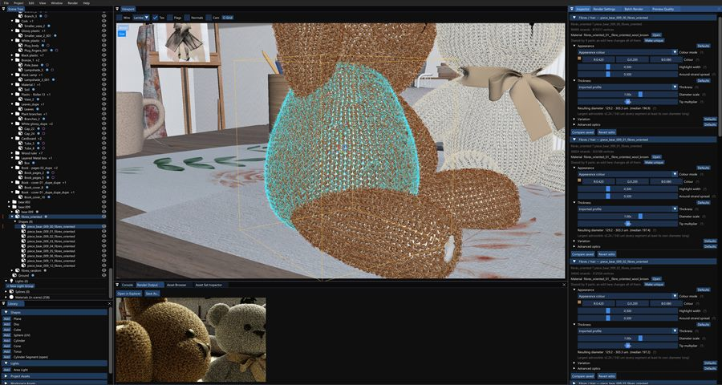</a>

## Kroken

[*Kroken*](https://www.lucydreams.it/kroken/) — Angelo Ferretti / Lucy Dreams · [CC BY-ND 4.0](https://creativecommons.org/licenses/by-nd/4.0/) · rendered with the author’s permission · [note](#kroken--noderivatives-permission-granted)

<a href="images/06_kroken/Camera_01_Main_001.png">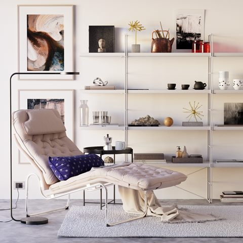</a>
<a href="images/06_kroken/Camera_01b_Main_Clay.png">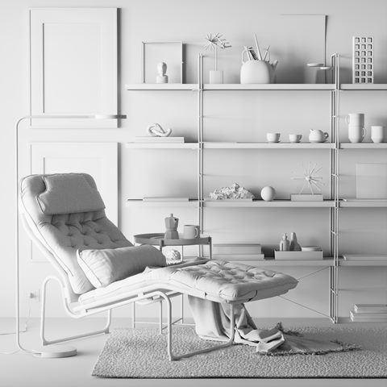</a>
<a href="images/06_kroken/Camera_02_Chaise_Longue_001.png">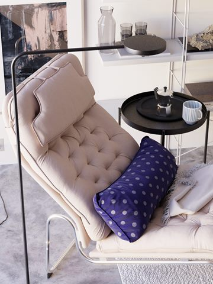</a>
<a href="images/06_kroken/Camera_03_Shelf_001.png">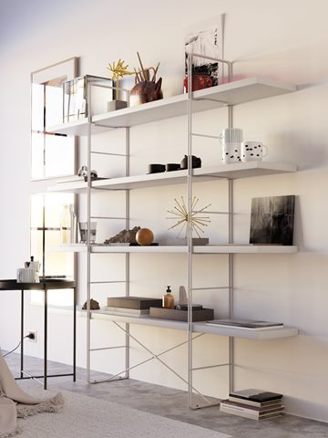</a>
<a href="images/06_kroken/Camera_04_Shelf_Detail_001.png">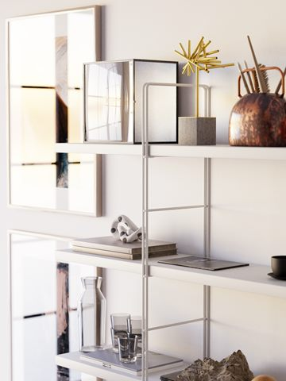</a>
<a href="images/06_kroken/Camera_05_Blanket_Detail_Top_001.png">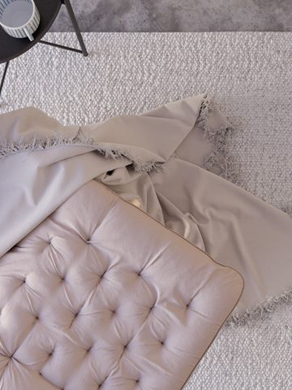</a>
<a href="images/06_kroken/Camera_06_Blanket_Detail_Front_002.png">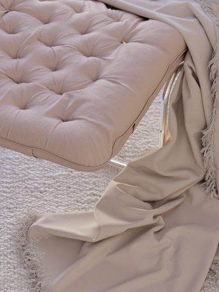</a>
<a href="images/06_kroken/Camera_07_Moka_Detail_001.png">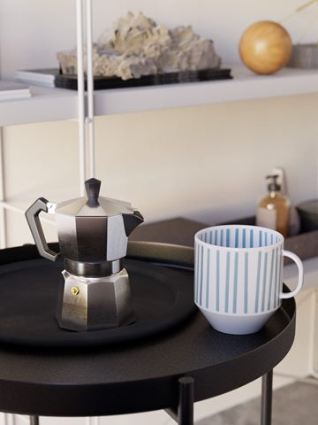</a>
<a href="images/06_kroken/Camera_08_dispenser.png">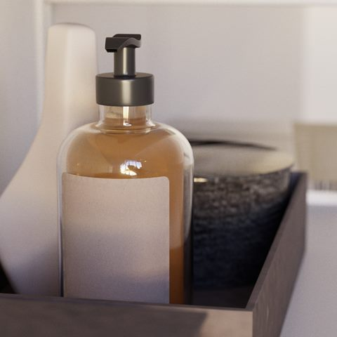</a>
<a href="images/06_kroken/Camera_09_red_glasses.png">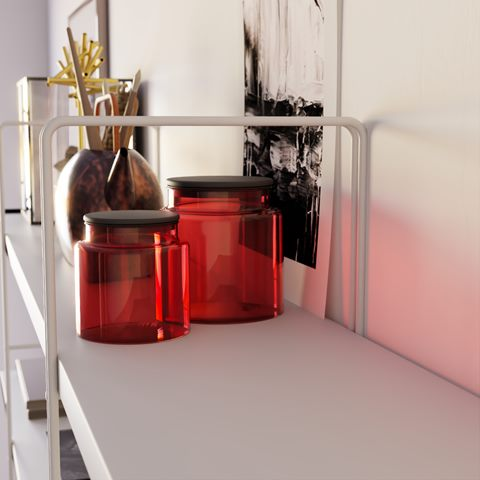</a>

## Bistro

[*Amazon Lumberyard Bistro*](https://developer.nvidia.com/orca/amazon-lumberyard-bistro) — Amazon Lumberyard · [CC BY 4.0](https://creativecommons.org/licenses/by/4.0/)

<a href="images/07_bistro/01_bistro_vespa.png">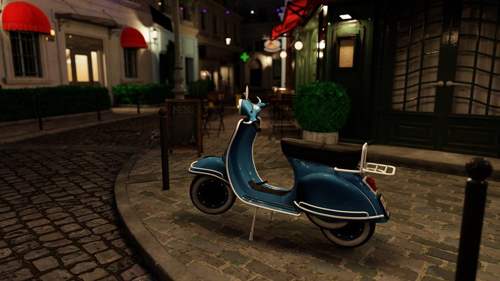</a>
<a href="images/07_bistro/02_bistro_cafe.png">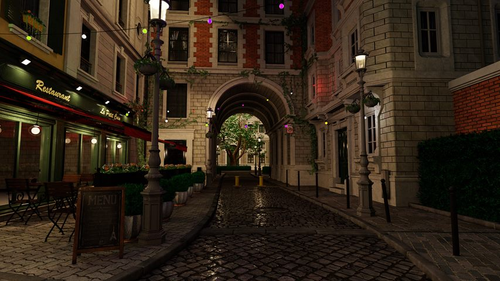</a>
<a href="images/07_bistro/03_bistro_le_chevalier.png">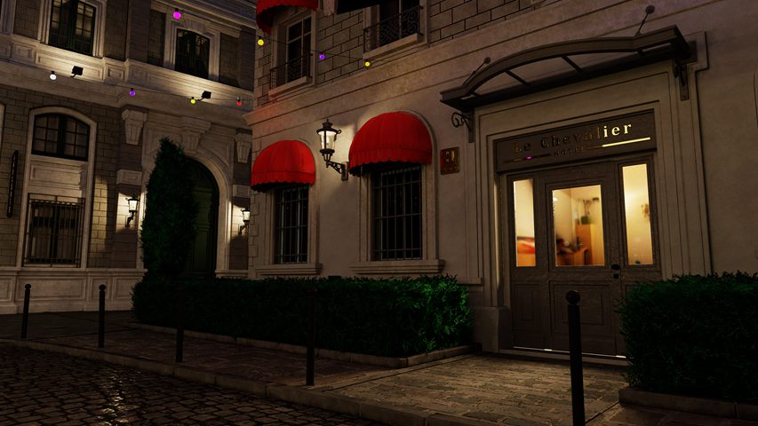</a>
<a href="images/07_bistro/04_clay.png">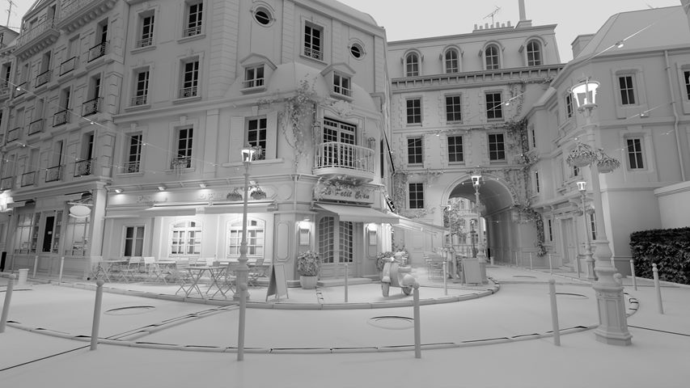</a>

## Zero-Day

[*Zero-Day*](https://www.beeple-crap.com/resources) — Mike Winkelmann (Beeple) · [free for any use](https://www.beeple-crap.com/resources)

<a href="images/08_zeroday/zeroday1.png">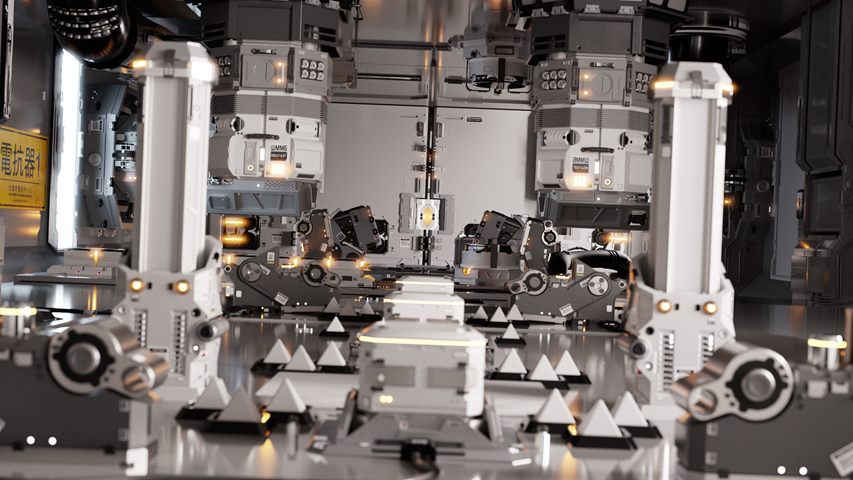</a>
<a href="images/08_zeroday/zeroday2.png">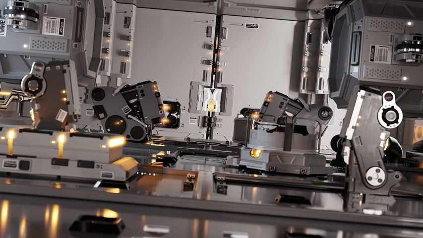</a>

## Bathroom

[*Bathroom Scene 15*](https://www.fab.com/listings/0a045566-e87c-4c54-927b-b40173523681) — PHI Archviz · [Fab Standard License](https://www.fab.com/eula)

<a href="images/09_bathroom/bathroom.png">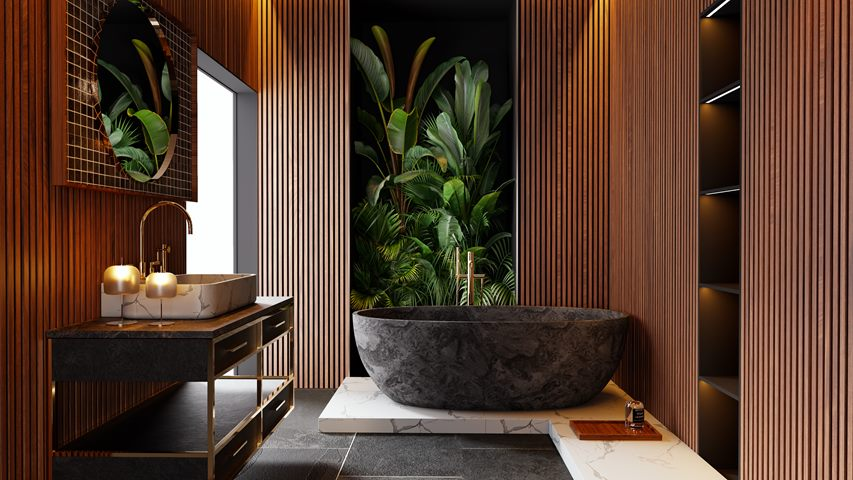</a>

## Monster Under the Bed

[*Monster Under the Bed*](https://www.blender.org/download/demo-files/) — Metin Seven, concept art by Blake Stevenson · [CC BY 4.0](https://creativecommons.org/licenses/by/4.0/)

<a href="images/10_monster_under_bed/monster_under_bed.png">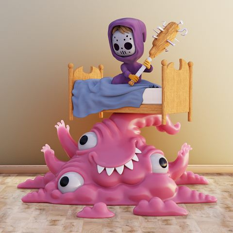</a>

## Classroom

[*Class room*](https://www.blender.org/download/demo-files/) — Christophe Seux · [CC0](https://creativecommons.org/publicdomain/zero/1.0/)

<a href="images/11_classroom/classroom.png">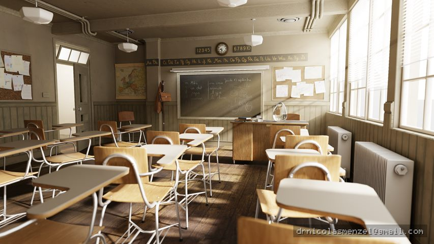</a>

## Transparent Machines

[*Transparent Machines*](https://www.beeple-crap.com/films) — Mike Winkelmann (Beeple) · [free for any use](https://www.beeple-crap.com/resources)

<a href="images/12_transparent_machines/01_main.png">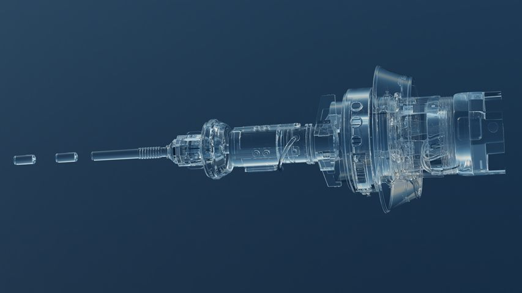</a>
<a href="images/12_transparent_machines/02_main.png">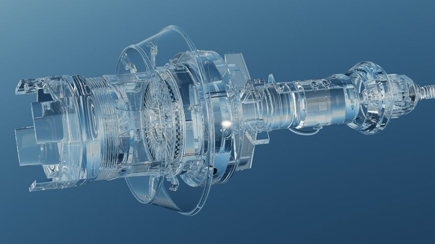</a>

## MaterialX Lion

[*MaterialX Teapot and Lion*](https://dpel.aswf.io/materialx-teapot-lion/) — MaterialX Teapot and Lion Copyright 2026 NVIDIA Corporation. All rights reserved. · [ASWF Digital Assets License v1.1](https://dpel.aswf.io/materialx-teapot-lion/materialx-teapot-lion-license) · [note](#materialx-lion--aswf-digital-assets-license)

<a href="images/13_lion/lion1.png">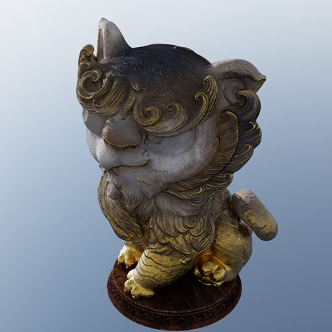</a>
<a href="images/13_lion/lion2.png">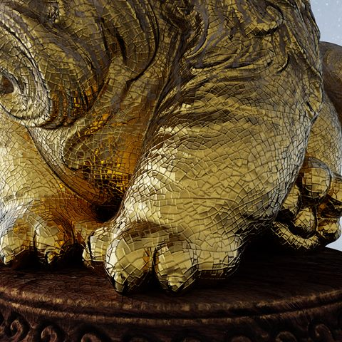</a>

## The Old View

[*Mall From The Oldest View*](https://www.cgtrader.com/3d-models/interior/other/mall-from-the-oldest-view-project-files-and-assets) — Šime Bugarija · [CGTrader Royalty Free License](https://www.cgtrader.com/pages/terms-and-conditions) · left: Blender 5.1, right: my path tracer, both rendered by me · [note](#the-old-view--blender-comparison)

<table>
  <tr><th>Blender 5.1</th><th>My path tracer</th></tr>
  <tr>
    <td><a href="images/14_the_old_view/01_blender.png">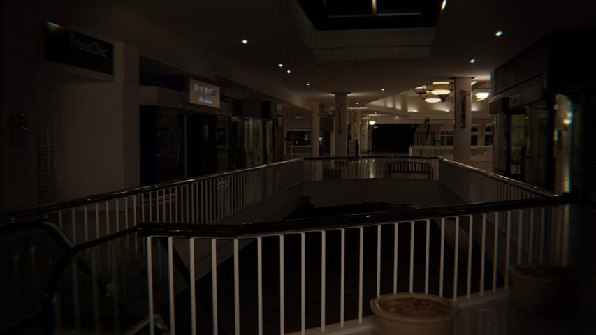</a></td>
    <td><a href="images/14_the_old_view/01_mine.png">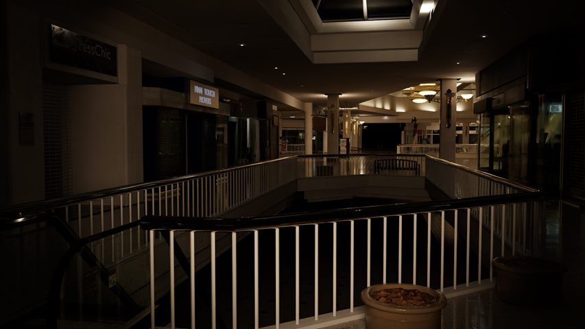</a></td>
  </tr>
  <tr>
    <td><a href="images/14_the_old_view/02_blender.png">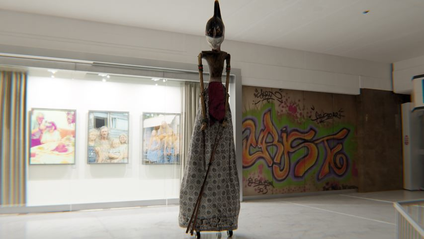</a></td>
    <td><a href="images/14_the_old_view/02_mine.png">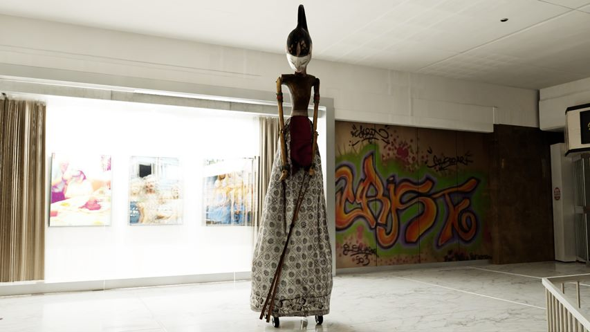</a></td>
  </tr>
  <tr>
    <td><a href="images/14_the_old_view/03_blender.png">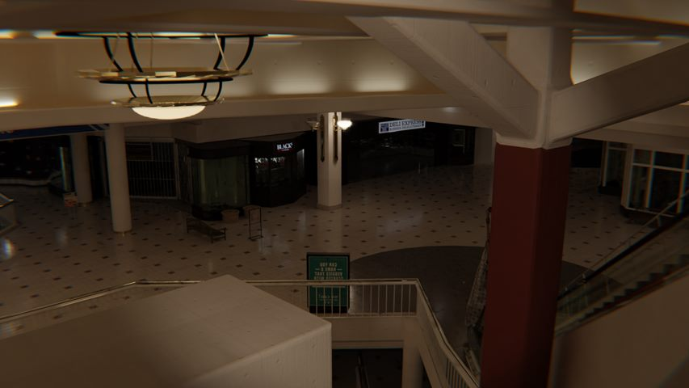</a></td>
    <td></td>
  </tr>
</table>

## Studies

- **Hornet** — [*Silksong || Hornet Fanart*](https://sketchfab.com/3d-models/silksong-hornet-fanart-57d431b977c841ef8c117af82f109890) — dark_igorek · [CC BY 4.0](https://creativecommons.org/licenses/by/4.0/) · [unofficial fan art](#fan-art-notice-hornet)
- **Gelatinous Cube** — [*Gelatinous Cube*](https://sketchfab.com/3d-models/gelatinous-cube-e08385238f4d4b59b012233a9fbdca21) — glenatron · [CC BY-NC 4.0](https://creativecommons.org/licenses/by-nc/4.0/) · [unofficial fan art](#fan-art-notice-gelatinous-cube)
- **Staircase** — [*The Wooden Staircase*](https://blendswap.com/blend/14449) — Wig42 · [CC BY](https://creativecommons.org/licenses/by/3.0/)
- **4060.b Spaceship** — [*4060.b Spaceship*](https://blendswap.com/blend/13489) — thecali · [CC0](https://creativecommons.org/publicdomain/zero/1.0/)

---

## Credits & licenses

All images here are renders I produced with my own path tracer — except the
left-hand images of [The Old View](#the-old-view) comparison, which I
rendered in Blender 5.1. The underlying
3D scenes and models were created by the artists credited below and used under
the stated licenses; **each render is a new image derived from those assets.**
Trademarks and characters are the property of their respective owners.

| Render | Scene / model — author | Source | License |
| --- | --- | --- | --- |
| Poolhouse *(heavily modified)* | *Modern luxury villa house building with pool* — zigurat architecture studio | [Sketchfab](https://sketchfab.com/3d-models/modern-luxury-villa-house-building-with-pool-0e858284939343cb994233d40a48a20a) | [CC BY 4.0](https://creativecommons.org/licenses/by/4.0/) |
| Bistro (Café, Vespa, Le Chevalier) | *Amazon Lumberyard Bistro* — Amazon Lumberyard | [NVIDIA ORCA](https://developer.nvidia.com/orca/amazon-lumberyard-bistro) · [pbrt-v4-scenes](https://github.com/mmp/pbrt-v4-scenes) | [CC BY 4.0](https://creativecommons.org/licenses/by/4.0/) |
| Zero-Day | *Zero-Day* — Mike Winkelmann (Beeple) | [beeple-crap.com/resources](https://www.beeple-crap.com/resources) | Free for any use, no attribution required (credited voluntarily) |
| Transparent Machines | Models from *Transparent Machines* — Mike Winkelmann (Beeple) | [beeple-crap.com/films](https://www.beeple-crap.com/films) · [pbrt-v4-scenes](https://github.com/mmp/pbrt-v4-scenes) | [Free for any use](https://www.beeple-crap.com/resources), no attribution required (credited voluntarily) |
| MaterialX Lion | *MaterialX Teapot and Lion* — NVIDIA Corporation | [ASWF blog](https://www.aswf.io/blog/materialxteapotlion/) · [DPEL](https://dpel.aswf.io/materialx-teapot-lion/) | [ASWF Digital Assets License v1.1](https://dpel.aswf.io/materialx-teapot-lion/materialx-teapot-lion-license) (non-commercial permitted uses; copyright notice required) |
| Hornet | *Silksong \|\| Hornet Fanart* — dark_igorek | [Sketchfab](https://sketchfab.com/3d-models/silksong-hornet-fanart-57d431b977c841ef8c117af82f109890) | [CC BY 4.0](https://creativecommons.org/licenses/by/4.0/) |
| Gelatinous Cube | *Gelatinous Cube* — glenatron | [Sketchfab](https://sketchfab.com/3d-models/gelatinous-cube-e08385238f4d4b59b012233a9fbdca21) | [CC BY-NC 4.0](https://creativecommons.org/licenses/by-nc/4.0/) (attribution required; non-commercial use only) |
| 4060.b Spaceship | *4060.b Spaceship* — thecali | [Blend Swap #13489](https://blendswap.com/blend/13489) | [CC0 1.0](https://creativecommons.org/publicdomain/zero/1.0/) (public domain; credited voluntarily) |
| Classroom | *Class room* — Christophe Seux | [Blender Demo Files](https://www.blender.org/download/demo-files/) | [CC0 1.0](https://creativecommons.org/publicdomain/zero/1.0/) (public domain; credited voluntarily) |
| Monster Under the Bed | Metin Seven, based on 2D concept art by Blake Stevenson | [Blender Demo Files](https://www.blender.org/download/demo-files/) | [CC BY 4.0](https://creativecommons.org/licenses/by/4.0/) |
| Staircase | *The Wooden Staircase* — Wig42 | [Blend Swap #14449](https://blendswap.com/blend/14449) | [CC BY](https://creativecommons.org/licenses/by/3.0/) |
| Bathroom | *Bathroom Scene 15* — PHI Archviz | [Fab](https://www.fab.com/listings/0a045566-e87c-4c54-927b-b40173523681) | [Fab Standard License](https://www.fab.com/eula) (Personal/Professional; no attribution required, credited voluntarily) |
| Kroken | Angelo Ferretti / Lucy Dreams | [lucydreams.it](https://www.lucydreams.it/kroken/) · [pbrt-v4-scenes](https://github.com/mmp/pbrt-v4-scenes) | [CC BY-ND 4.0](https://creativecommons.org/licenses/by-nd/4.0/) |
| Watercolor *(environment map replaced)* | *Watercolor room interior scene* — Angelo Ferretti / Lucy Dreams | [Lucy Dreams shop](https://gum.co/urfLv) · [pbrt-v4-scenes](https://github.com/mmp/pbrt-v4-scenes/tree/master/watercolor) | [Lucy Dreams EULA](https://www.lucydreams.it/shop/eula-license/) (purchased 2026-10-12; no attribution required, credited voluntarily) |
| Knitted Bears *(modified)* | *Teddy bears* — hectopod | [Sketchfab](https://sketchfab.com/3d-models/teddy-bears-e84b12b4ac20402aaf4d40f2219cd0e2) | [CC BY 4.0](https://creativecommons.org/licenses/by/4.0/) (background scene: Watercolor, see above) |
| The Old View | *Mall From The Oldest View – Project Files and Assets* — Šime Bugarija | [CGTrader](https://www.cgtrader.com/3d-models/interior/other/mall-from-the-oldest-view-project-files-and-assets) | [CGTrader Royalty Free License](https://www.cgtrader.com/pages/terms-and-conditions) (purchased for US$9; no attribution required, credited voluntarily) |

### Fan-art notice (Hornet)

The Hornet render is **unofficial fan art**. The character Hornet and *Hollow
Knight: Silksong* are trademarks and/or copyright of **Team Cherry**. This
non-commercial render is not affiliated with, authorized, sponsored, or endorsed
by Team Cherry. The underlying 3D model, *Silksong \|\| Hornet Fanart* by
dark_igorek, is used under [CC BY 4.0](https://creativecommons.org/licenses/by/4.0/).

### Fan-art notice (Gelatinous Cube)

The Gelatinous Cube render is **unofficial fan art**. The gelatinous cube is a
*Dungeons & Dragons* monster; D&D and its trade dress are trademarks of
**Wizards of the Coast**, and this render is not affiliated with, authorized,
sponsored, or endorsed by them. (The creature's game statistics appear in the
[CC BY 4.0](https://creativecommons.org/licenses/by/4.0/)-licensed SRD 5.1, but
that covers the rules text, not this artwork.)

The underlying 3D model, *Gelatinous Cube* by **glenatron**, is licensed
[CC BY-NC 4.0](https://creativecommons.org/licenses/by-nc/4.0/). Attribution is
given above, and the **NonCommercial** term is respected: this site carries no
advertising, sells nothing, and the renders are neither licensed nor offered for
sale. Should this portfolio ever be monetized, this render must be pulled or
separate permission obtained from the author.

### Kroken — NoDerivatives, permission granted

The Kroken scene is licensed **CC BY-ND 4.0**, which technically excludes
derivative works such as renders. Angelo Ferretti (Founder & Director, Lucy
Dreams — the scene's author), granted written permission by email on
**2026-07-03** to publish rendered images of the scene in this context,
subject to Lucy Dreams' [shop EULA/license
terms](https://www.lucydreams.it/shop/eula-license/). That email is kept on
file as proof of permission.

### Watercolor — Lucy Dreams EULA (purchased)

The [*Watercolor room interior scene*](https://gum.co/urfLv) by **Angelo
Ferretti** (Lucy Dreams) was purchased on **2026-10-12** under the
[Lucy Dreams EULA](https://www.lucydreams.it/shop/eula-license/), which permits
creating renderings from the scene, in personal and commercial work, and
modifying it for that purpose. It does not require attribution; the author is
credited here voluntarily. The renders were made from the scene's pbrt-v4 port in
[pbrt-v4-scenes](https://github.com/mmp/pbrt-v4-scenes/tree/master/watercolor),
using its supplied cameras with a replaced environment map from
[Poly Haven](https://polyhaven.com/hdris) ([CC0](https://creativecommons.org/publicdomain/zero/1.0/); no attribution
required, credited voluntarily). The scene files
themselves are not redistributed. The receipt is kept on file as proof of
license.

### Knitted Bears — CC BY 4.0 model in a purchased scene

The bears are the
[*Teddy bears*](https://sketchfab.com/3d-models/teddy-bears-e84b12b4ac20402aaf4d40f2219cd0e2)
model by **hectopod**, licensed [CC BY 4.0](https://creativecommons.org/licenses/by/4.0/).
I modified it by adding knitted yarn fibres and materials and placing it in a
new scene. The background is the Watercolor scene described above, used under
the same purchased Lucy Dreams EULA, which permits modifying the scene for
renderings. Only rendered images and editor screenshots are published; neither
the bear model nor the scene files are redistributed.

### Bathroom — Fab Standard License

The *Bathroom Scene 15* asset by **PHI Archviz** was purchased on
[Fab](https://www.fab.com/listings/0a045566-e87c-4c54-927b-b40173523681) under the
[Fab Standard License](https://www.fab.com/eula). That license grants the right to
use and modify the asset to produce final rendered images ("linear" end products
such as the still shown here) and to display it publicly. It does **not**
require attribution — the author is credited here voluntarily — and it does **not**
permit redistributing the underlying 3D asset files themselves. Only rendered
images are published in this repository, so the license terms are respected.

### MaterialX Lion — ASWF Digital Assets License

The lion renders show the *MaterialX Teapot and Lion*, an asset contributed
by **NVIDIA** to the Academy Software Foundation's [Digital Production Example
Library](https://dpel.aswf.io/materialx-teapot-lion/). Required notice:

> MaterialX Teapot and Lion Copyright 2026 NVIDIA Corporation. All rights reserved.

The [ASWF Digital Assets License
v1.1](https://dpel.aswf.io/materialx-teapot-lion/materialx-teapot-lion-license)
permits use for education, training, research, software and hardware
development, benchmarking and product demonstrations — which is what these
renders are — and requires publications showing derived images to carry that
copyright notice. The underlying asset files are **not** redistributed here, and
nothing in this repository implies endorsement by, sponsorship by, or
affiliation with NVIDIA.

### The Old View — Blender comparison

The mall scene, *Mall From The Oldest View – Project Files and Assets* by
**Šime Bugarija**, was purchased on
[CGTrader](https://www.cgtrader.com/3d-models/interior/other/mall-from-the-oldest-view-project-files-and-assets). Its license permits rendering the scene and publishing the resulting
images; the underlying 3D files are **not** redistributed in this repository.

Every image in the comparison — the Blender side included — was rendered by me
from the same scene and cameras. **Blender** is a registered trademark of the
Blender Foundation; this comparison is not affiliated with or endorsed by the
Blender Foundation. The mall is a replica of Valley View Mall (Dallas),
popularized by Kane Pixels' series *The Oldest View*; this repository is not
affiliated with Kane Pixels.

### Rights holders

Attribution and licenses above are provided in good faith. If you are a rights
holder and have a concern about any asset used here, contact
**drnicolasmenzel@gmail.com** and I will promptly address it.

---

> **Note:** The Old View entry assumes the CGTrader Royalty Free License; confirm
> the license named on your CGTrader order and update it if it differs.
>
> **Note:** The Staircase entry lists CC BY; confirm the exact CC-BY version
> shown on the [Blend Swap page](https://blendswap.com/blend/14449) and update
> the license link if it differs.

---
